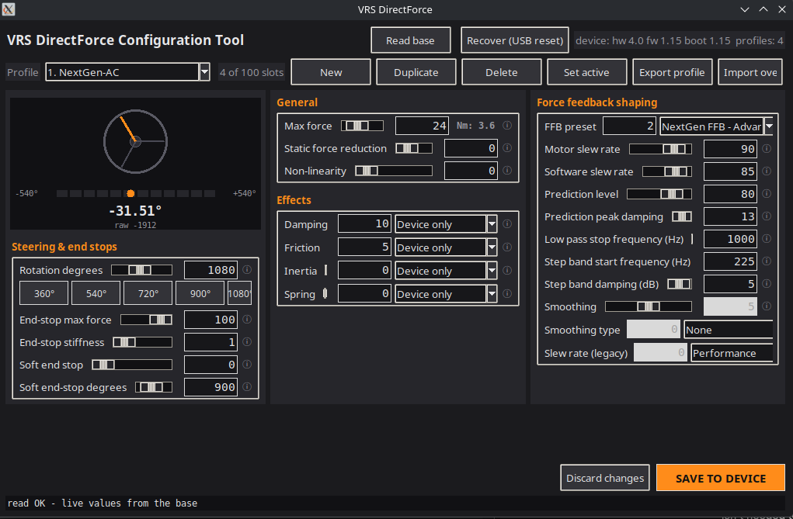

# vrs-config — native Linux configurator for VRS DirectForce Pro wheel bases

An unofficial, open-source tool to read and write the **settings and profiles**
of VRS DirectForce Pro wheel bases (tested: **DFP15**, hw 4.0 / fw 1.15) on
Linux — no Windows, no Wine, no VM. Force feedback and steering work natively
through `hid-universal-pidff`; this tool covers the missing piece: the
configuration app.

It speaks the base's own protocol over raw USB: the 512-byte vendor feature
report `0x66`, protobuf payloads, and the device's self-described settings
schema (read live from the base as `SimWheelBase.proto`). Everything was
reverse-engineered from the vendor's own SDK and validated byte-for-byte
against recorded traffic of the official Windows tool on the author's base. See [PROTOCOL.md](PROTOCOL.md).

```
  $ vrs-config-gui            ← VRS One-style desktop GUI
```



## Features

- **CLI** (`vrs-config.py`, Python 3 stdlib only):
  `versions` · `header` · `profiles` · `schema` · `sweep` · `raw` ·
  `set-profile` (whole-store save burst, dry-run first) · `--recovery`
- **GUI** (`vrs-config-gui.py`, Tk): dark VRS One-style three-column form,
  live steering-angle gauge (reads the 1 kHz joystick stream), per-effect
  *Device / Game / Device+game* override dropdowns, integer sliders, `Nm:`
  torque readout derived from Max force, profile
  **New / Duplicate / Delete / Set active / Rename / Export / Import**,
  unsaved-change counter, whole-store save behind one confirm,
  *Recover (USB reset)* button.
- Field labels/ranges/help text generated from the base's own proto schema —
  if VRS adds a setting, the form picks it up.

## Requirements

- Linux (developed on kernel 7.0 / Ubuntu 26.04; any distro with usbdevfs)
- Python ≥ 3.9; GUI additionally needs `python3-tk`
  (`sudo apt install python3-tk`)
- Wheel base on **application firmware** (not the DFU/bootloader); firmware
  updates are deliberately **not** supported — keep using the official tool on
  Windows for that (rare: settings persist in flash).

## Setup

```bash
./install.sh                # checks + udev rules + installs app to /opt/vrs-config
                            # and registers `vrs-config` / `vrs-config-gui` on PATH
./install.sh --check        # dependency/base checks only (no sudo, no changes)
./install.sh --uninstall    # remove again
```

The **udev entries required for the DFP15** (`/etc/udev/rules.d/99-vrs-dfp.rules`:
seat-user access to the wheel base's `/dev/bus/usb` + hidraw nodes) are
installed by `./install.sh`. After installation you may just run the commands
from PATH, **without sudo**:

```bash
vrs-config versions          # or vrs-config-gui
```

Reading and writing uses the **raw USB transport**: the tool claims the base's
USB interface and talks EP0 directly, exactly like Windows hidclass does. It
unbinds the kernel HID driver from the base while it runs - if that needs more
rights than your session has (e.g. right after a replug), it prints a notice
and one `sudo` run fixes it permanently for the current session.

While unbound there is no joystick/FFB; **replug the USB cable** (or write
`bind` to the driver) when you are done configuring to play again. If a
previous session died mid-connection and reads stall (a *stale connection*),
press the GUI's **Recover (USB reset)** button (CLI: `./vrs-config.py
--recovery`) — it does a plain USB reset, no power cycle needed.

**Run only one instance at a time.** The tool claims the USB interface
exclusively and the base gates each connection (handshake → commit); a
second `vrs-config-gui` (or a CLI + GUI mix) fights the first one for the
claim and leaves stale connections behind — press **Recover (USB reset)**
afterwards. Start a new one only after the previous has exited.

## How it works (short version)

Every transaction is a 512-byte feature report `0x66`: header (random
per-connection `client_id`, per-operation nonce, request counter), a
13-byte zero var-header, then a protobuf payload at offset 32, CRC-32 (zlib)
over bytes 0–507 stored at 508. A connection is a `0x00` handshake first
frame, `0x01` commit last frame. Reads: `0x02` settings header, `0x04`
profile (protobuf `{1: index}`), `0x07` versions, `0x0E` chunked schema,
`0x15`/`0x17` calibration passthrough. **Every write rewrites the whole
profile store** (`00 → 16 → 19 → 03 → 06×N → 01`) — that is not a limitation
of this tool, it is how the base works (the official software does exactly the
same). Full detail: [PROTOCOL.md](PROTOCOL.md).

## Safety

- **One instance at a time** — the USB interface claim is exclusive and the
  base only supports one gated connection; a second GUI/CLI instance will
  conflict with the first.
- Channels `0x08`/`0x09` (firmware/bootloader region) are **hard-refused**.
- Writes are gated: `--allow-write` (CLI) / explicit confirm (GUI), and the
  tool only ever re-submits bytes it just read back.
- The author's base survived months of development with its data intact;
  it is still your wheel — keep a known-good profile exported
  (`Export profile`) before experimenting.

## Status / compatibility

Live-tested against a DFP15 (hw 4.0, fw 1.15). The protocol is presumably
shared by the rest of the DirectForce Pro family (the SDK ships profiles for
DFP10/Lite/R295 variants), but no other model has been tested — reports
welcome.

## Testing

Offline unit tests (no hardware needed):

```bash
python3 -m unittest discover -s tests
```

They cover the 512-byte frame build/parse and CRC rule, the channel safety
policy, the protobuf codec (including the multi-byte-tag regression for
fields >= 16), device schema parsing and the angle-gauge math.

## Disclaimer

Not affiliated with Smarty Co. / VRS. "VRS", "DirectForce" are their owners'
trademarks. Protocol data was reverse-engineered from publicly shipped
software and protocol recordings of the author's own hardware, for interoperability.

## License

MIT — see [LICENSE](LICENSE).
